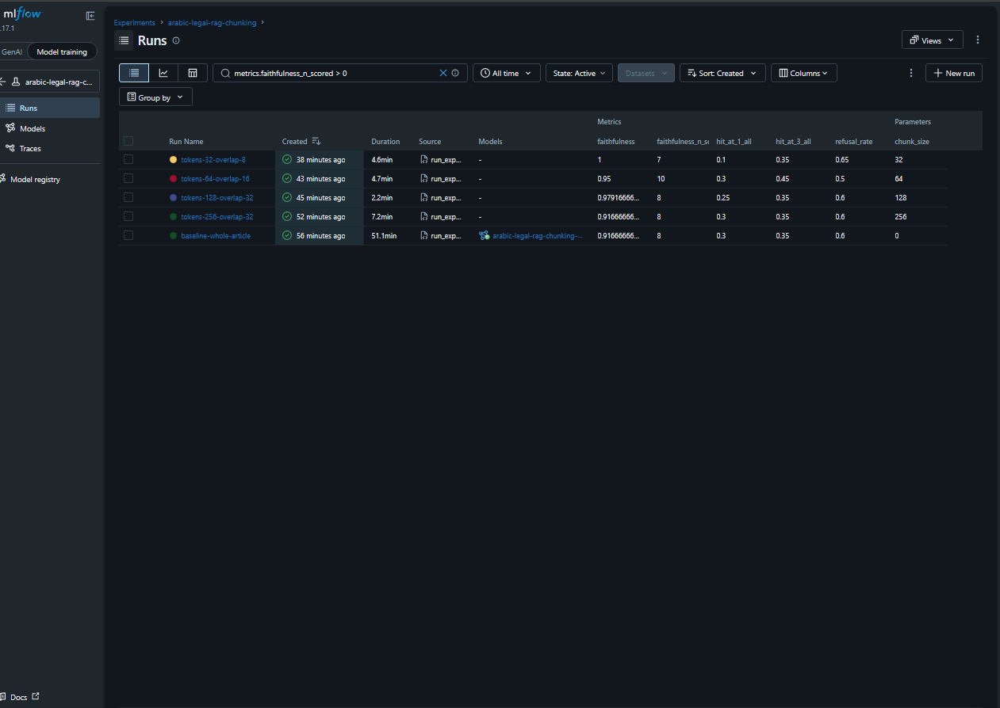

# Arabic Legal RAG - Egyptian Civil Code Q&A

A retrieval-augmented question-answering service over the **Egyptian Civil Code**
(bilingual Arabic/English PDF). Ask a question in Arabic; get a grounded answer
plus the Civil Code articles it was retrieved from.

> Status: **Session 2 (experiment tracking, data versioning, CI)**. Production
> serving, optimization and monitoring are planned for later sessions.

## Quick start (3 commands)

Requirements: Docker and a Gemini API key (the free tier works; the model used
during development allowed about 15 requests per minute).

```bash
git clone https://github.com/elshhawy/arabic-legal-rag && cd arabic-legal-rag
cp .env.example .env     # Windows: copy .env.example .env  (then set GEMINI_API_KEY and GEMINI_MODEL in .env)
docker compose up
```

`docker compose up` pulls `ghcr.io/elshhawy/arabic-legal-rag:latest`, which CI
publishes on every merge to `main`. The image already contains the corpus, the
vector index and the embedding model, so no data download and no DVC are needed;
the container only needs internet access to call Gemini. The API key is read from
`.env` at run time and is never copied into the image.

In a second terminal:

```bash
curl localhost:8000/health
curl -X POST localhost:8000/ask -H "Content-Type: application/json" --data-binary "@examples/ask.json"
```

Ports: 8000. No GPU needed. The first request may be slower while the embedding model loads.

## Architecture

```
PDF  ->  extract.py  ->  civil_code.json  ->  validate.py
                                                  |
        params.yaml -> build_index.py  <----------+
                              |
                  Chroma vector index (chunking set by params.yaml)
                              |
   /ask  ->  embed query  ->  top-3 retrieval  ->  Gemini (grounded prompt)  ->  answer + sources
```

```
data/*.dvc + dvc.yaml --dvc pull / dvc repro--> data/processed + data/chroma_index
scripts/run_experiments.py --> MLflow (hit@k, faithfulness) --> Model Registry alias "production"
GitHub Actions: ruff + pytest | dvc pull, faithfulness gate (>= 0.75), docker build, push to GHCR
```

- **Extraction:** `pdfplumber`, two-column layout (English left, Arabic right),
  Arabic visual-order fix, Arabic-Indic digits to `int`, repealed articles flagged
  (`is_repealed: true`) instead of deleted.
- **Embeddings:** `intfloat/multilingual-e5-small` (with the required `query:` /
  `passage:` prefixes). The model name is stored in the index metadata and checked
  at API startup, so a mismatched index fails loudly.
- **Chunking:** `params.yaml` (`index.chunk_size`, `index.overlap`, in e5 tokens).
  `chunk_size: 0` means one chunk per whole article (the baseline). Chunks of the
  same article are merged back before they reach the LLM.
- **Vector store:** ChromaDB (persistent, local).
- **LLM:** Google Gemini via `google-genai`; the model name comes from `.env`.
- **API:** FastAPI, JSON logs with a per-request id (`X-Request-ID` header).

## Repository structure

```
src/legalrag/   arabic, extract, validate, chunking, embeddings, llm, api, logging_config
scripts/        build_index, run_experiments, export_report, register_best,
                faithfulness_scoring, faithfulness_gate, eval_retrieval, make_eval_set,
                spot_check, ask_demo, embed_demo
tests/          unit tests (API, LLM client, Arabic helpers, validation, chunking, retrieval)
data/eval/      20-question evaluation set (DVC-tracked)
reports/        extraction report, experiment table, MLflow screenshot
examples/       ask.json (sample /ask request)
dvc.yaml, params.yaml, .github/workflows/ci.yml
Dockerfile, docker-compose.yml, docker-compose.build.yml, .env.example, pyproject.toml
```

## Run from source (development)

Requirements: Python 3.10+, a Gemini API key.

```bash
pip install -e ".[dev]"
cp .env.example .env     # set GEMINI_API_KEY and GEMINI_MODEL
dvc pull                 # needs access to the DVC remote, see "Known limitations"
uvicorn legalrag.api:app --port 8000
```

Rebuild the data from the PDF with the DVC pipeline (`extract` -> `validate` ->
`index`, parameters from `params.yaml`):

```bash
dvc repro
```

Build the Docker image from your local data instead of pulling it:

```bash
docker compose -f docker-compose.yml -f docker-compose.build.yml up --build
```

## Experiments (MLflow)

Five chunking configurations were compared on the 20-question evaluation set
(`data/eval/test_set.jsonl`, k = 3). Table generated by `scripts/export_report.py`
from the MLflow runs (newest run of each configuration):

| Run | chunk_size | overlap | chunks | hit@1 all | hit@3 all | hit@3 ar | hit@3 en | faithfulness | scored / asked | refusal rate | judge |
|---|---|---|---|---|---|---|---|---|---|---|---|
| baseline-whole-article | 0 | 0 | 1093 | 0.30 | 0.35 | 0.60 | 0.10 | 0.92 | 8 / 20 | 0.60 | gemini-3.5-flash-lite |
| tokens-256-overlap-32 | 256 | 32 | 1096 | 0.30 | 0.35 | 0.60 | 0.10 | 0.92 | 8 / 20 | 0.60 | gemini-3.5-flash-lite |
| tokens-128-overlap-32 | 128 | 32 | 1228 | 0.25 | 0.35 | 0.60 | 0.10 | 0.98 | 8 / 20 | 0.60 | gemini-3.5-flash-lite |
| tokens-64-overlap-16 | 64 | 16 | 1900 | 0.30 | 0.45 | 0.80 | 0.10 | 0.95 | 10 / 20 | 0.50 | gemini-3.5-flash-lite |
| tokens-32-overlap-8 | 32 | 8 | 3510 | 0.10 | 0.35 | 0.70 | 0.00 | 1.00 | 7 / 20 | 0.65 | gemini-3.5-flash-lite |

How to read it:

- **hit@k** is the share of questions whose expected article is among the top-k
  retrieved articles. With 20 questions, one question is 5 percentage points.
- **faithfulness** is RAGAS faithfulness judged by `gemini-3.5-flash-lite` (the judge is the
  same Gemini model that writes the answers), averaged over the questions that
  were answered. A refusal ("not enough information") is not a claim about the
  law, so it is left out of that average and shown as **refusal rate**. Read the
  two columns together: a high refusal rate can hide behind a high faithfulness.
  `scored / asked` shows how many questions contributed.
- The judge sees the same `[<article word> N]` labels the answer model saw
  (without them every cited answer was marked unfaithful in an early run).
- Judge quality for Arabic with a small Gemini model is not verified.
- **What this experiment can and cannot show.** Between 50% and 65% of the questions were refused in these runs, so faithfulness rests on only 7-10 answered questions per run, and the answered questions are not the same in every run. hit@3 ranges from 0.35 to 0.45 and faithfulness from 0.92 to 1.00: with 20 questions that spread is about one or two questions, so these runs do not establish that one configuration is better than another.

Selection rule: the whole-article baseline stays the default unless faithfulness
clearly separates the runs, because changing it means rebuilding and re-publishing
the index.

**Model Registry:** `arabic-legal-rag-chunking-config`, alias `production` -> version 1 (run `baseline-whole-article`; faithfulness 0.9167 on 8 of 20 questions scored; refusal rate 0.6; hit@3 0.35). It is a configuration bundle: the registry records which chunking configuration was promoted and on what evidence, while `params.yaml` is what `build_index.py` reads.

Reproduce:

```bash
python scripts/run_experiments.py                 # logs params, hit@k, faithfulness to mlflow.db
python scripts/export_report.py                   # rewrites reports/chunking_experiments.md
mlflow ui --backend-store-uri sqlite:///mlflow.db
```



## Continuous integration

`.github/workflows/ci.yml` has two jobs:

1. **lint-and-test** (every push and pull request): `ruff check`, `pytest`. No
   secrets or data needed; the API tests skip themselves without the index.
2. **data-gate-image** (enabled by the repository variable `ENABLE_DATA_JOBS=true`):
   `dvc pull` (Google Drive service account), `pytest` with the real index, the
   **faithfulness gate** (`scripts/faithfulness_gate.py`, fails below 0.75 on the
   20 questions), Docker build with a `/health` smoke test, and, on `main` only,
   the push to GitHub Container Registry.

Secrets and variables: `GDRIVE_CREDENTIALS_DATA`, `GEMINI_API_KEY`, `GEMINI_MODEL`.

## API

### `GET /health`
```json
{"status": "healthy", "documents_indexed": 1093}
```
`documents_indexed` is the number of non-repealed articles in the vector index
(1149 articles - 56 repealed = 1093, as measured from the running container).

### `POST /ask`
Request:
```json
{"question": "هل يجوز فسخ العقد؟"}
```
Response:
```json
{
  "answer": "...",
  "sources": [
    "Egyptian Civil Code, Article 157",
    "Egyptian Civil Code, Article 650"
  ]
}
```
Errors: `422` for an invalid body (missing or non-string `question`, or an empty /
whitespace-only question); `503` if answer generation fails (no internal
details are returned).

## Tests

```bash
pytest
```

API tests are skipped automatically if `data/chroma_index` does not exist.

## Known limitations

- **No "I don't know" enforcement in code.** The LLM is instructed (system prompt)
  to refuse when the retrieved articles are insufficient, but retrieval always
  returns the top-3 articles, and `sources` lists everything retrieved, not only
  what the answer used. A distance threshold needs measurement first.
- **Repealed articles are not indexed.** They are flagged in the corpus but excluded
  from retrieval, so the system cannot yet explain that an article was repealed.
- **Source PDF typos remain.** Scattered Arabic typos in the PDF are left as-is
  (only one verified typo was corrected); see `reports/extraction_report.json`.
- **The DVC remote is a private Google Drive folder.** The Docker quick start needs
  no data, but `dvc pull` and `dvc repro` need access to that folder (and a Google
  login) or the source PDF. CI uses a service account.
- **Evaluation is small.** 20 questions; faithfulness is judged by the generator
  model itself; retrieval of English questions is weaker than Arabic (see the
  `hit@3 en` column). Latency and throughput: not measured yet.
- Free-tier Gemini limits (about 15 requests per minute for the model used) make a
  full experiment run take tens of minutes.
- Docker rebuilds reinstall all dependencies whenever `src/` changes (the dependency
  layer is not cached separately).
- Importing `legalrag.embeddings` loads `sentence-transformers` eagerly, which makes
  some tests slow.

## Changelog

### Session 2 - Tracking and data versioning
- **Built:** DVC pipeline (`extract`, `validate`, `index`) with a Google Drive
  remote; configurable chunking (`params.yaml`); five chunking experiments logged
  to MLflow with hit@k and RAGAS faithfulness; the chosen configuration registered
  in the MLflow Model Registry (alias `production`); GitHub Actions workflow with
  a faithfulness gate and a GHCR image push; `.env.example`.
- **Decisions:** whole-article chunking stays the default unless the results
  clearly favour another configuration; refusals are excluded from the faithfulness
  average and reported as refusal rate; CPU-only torch in Docker and CI; the image
  is published to GHCR so a reviewer needs no DVC access.
- **Results:** see the experiments table above. Only the numbers in that table
  and in MLflow were measured.
- **Limitations:** see above.

### Session 1 - Foundation
- **Built:** PDF extraction to structured JSON (1149 articles, 56 flagged repealed),
  corpus validation (7 checks), article-level embeddings in Chroma, `/ask` and
  `/health`, structured logging, Dockerfile and compose file, unit tests.
- **Decisions:** one article = one chunk; e5-small multilingual embeddings; Gemini
  as the generator; index stores the embedding model name and the API verifies it.
- **Results:** container builds and serves; `/health` returns ok; `/ask` returns
  an Arabic answer with cited articles for a sample question. Quality: not measured yet.
